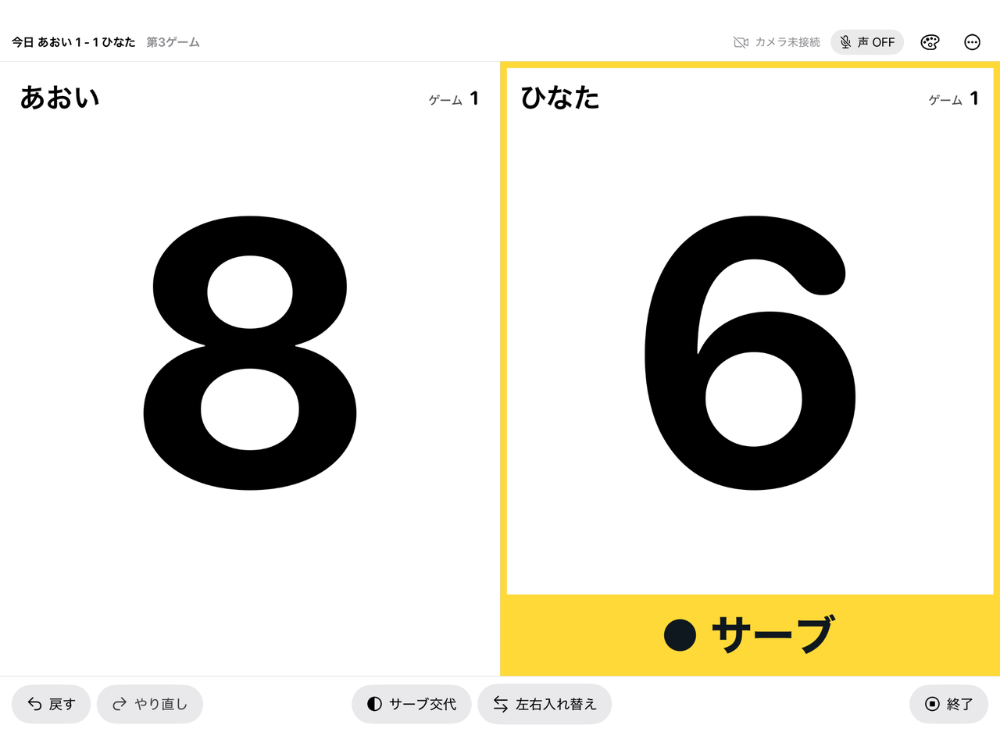
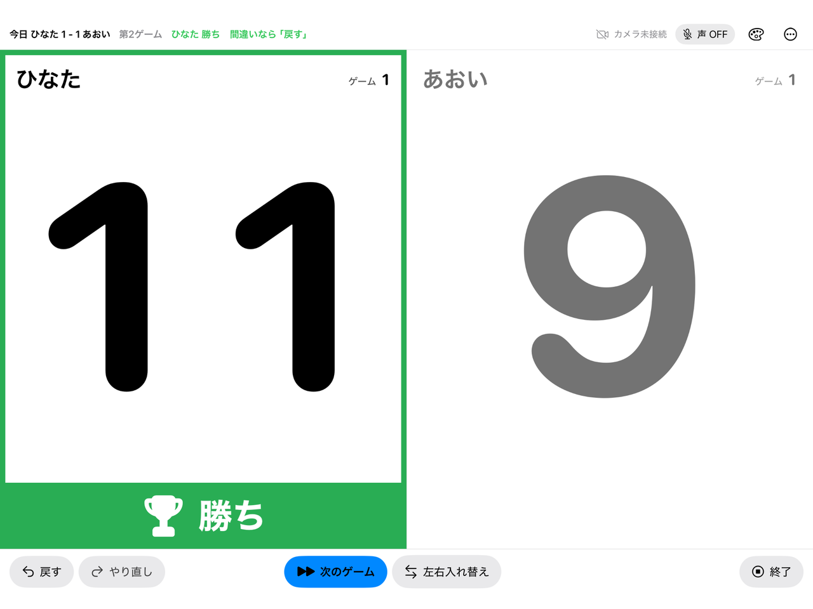
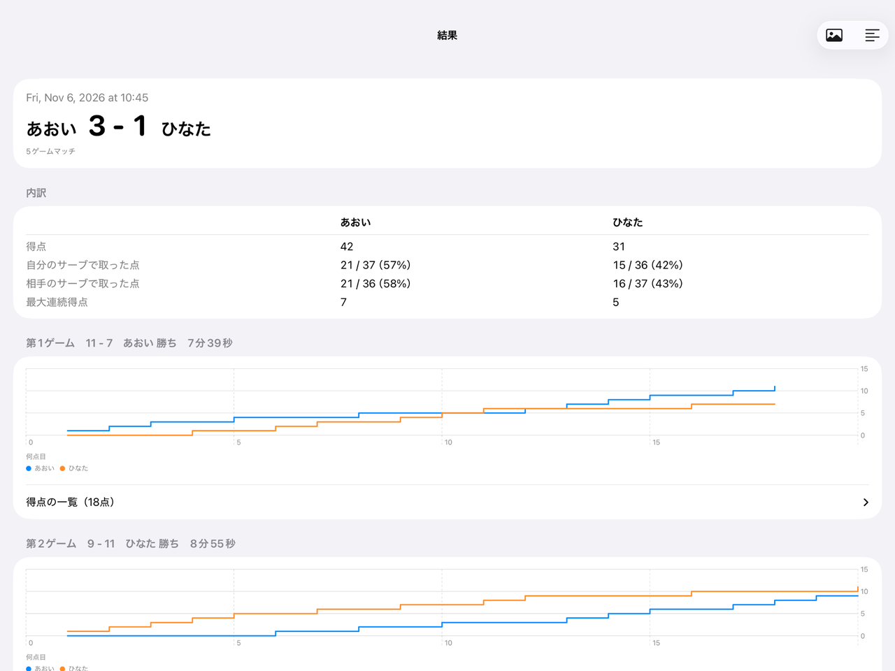
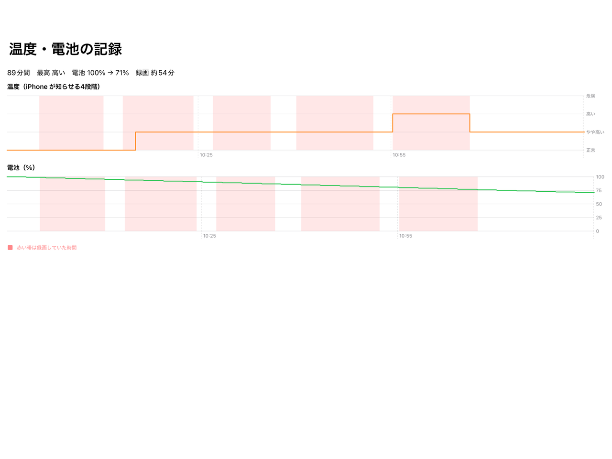

# TTLog

卓球の練習試合で、点数をつけながら記録を残す iOS / iPadOS アプリです。

- **スコアボード**（iPad を台の横に置く）：タップか声で点数を進めます。
- **カメラ**（iPhone）：スコアボードとつなぐと、ゲームごとに自動で録画します。

| スコアボード | ゲームが終わったとき |
|---|---|
|  |  |
| **結果と共有** | **カメラ端末の温度・電池** |
|  |  |

## できること

- **声で操作**：「ひだり」「みぎ」、選手の呼び名（「〇〇ポイント」なども可）、「戻して」「次のゲーム」と言えます。「ななさん」「スリーオール」のようにスコアを言っても進みます。
- **間違えても戻せる**：ゲームが終わっても画面はふさがず、勝ちの帯を出すだけです。「戻す」「やり直し」でいつでも直せます。
- **結果**：ゲームごとのスコアの推移、サーブ別の得点率、最大連続得点を出します。画像か文字で送れます。
- **録画**：ゲームごと（既定）か、記録中ずっと撮れます。動画の中で得点の場面へ飛べます。
- **端末の状態の記録**：カメラ側の温度と電池を10秒ごとに CSV に残し、グラフで見られます。

## 入れ方

1. [Actions の iOS Build](../../actions/workflows/ios.yml) から、最新の `ttlog-*.ipa` を落とします。
2. [Sideloadly](https://sideloadly.io/) で iPhone / iPad に入れます。
3. 起動して、端末の役割（スコアボード / カメラ）を選びます。

iOS / iPadOS 17 以上で動きます。App Store では配っていません。

## 開発

- Swift / SwiftUI / SwiftData。Xcode プロジェクトは [XcodeGen](https://github.com/yonaskolb/XcodeGen) で `project.yml` から作ります。
- 得点のルールと声の読み取りは `Packages/TTLogCore` にまとめ、`swift test` で確かめます（Linux でも動きます）。
- アプリのビルドは GitHub Actions の macOS で行います。キャプチャは `Screenshots` のワークフローで撮り直せます。
- 仕様は [SPEC.md](SPEC.md) にあります。

© rou39
